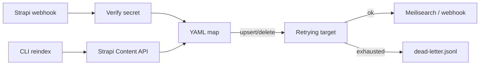

# Architecture

Short decisions for v0.1.0.

## ADR-001: YAML mapping owns the document shape

**Decision.** Each Strapi model maps to an index, id field, optional `api_id` for reindex, and a field rename table in YAML.

**Why.** Content types change in the CMS; keeping projection out of code means ops can adjust without a redeploy of business logic.

**Trade-off.** Nested components and relations need explicit flattening later. Absent fields are skipped, so a missing required search field fails silently at query time unless you test fixtures.

## ADR-002: Idempotency via `_source_updated_at`

**Decision.** Every upserted document stores the Strapi `updatedAt` as `_source_updated_at`. A later event is skipped when its timestamp is not newer.

**Why.** Strapi (and intermediaries) can deliver duplicates. Skipping stale writes keeps Meilisearch and webhook sinks convergent without a separate outbox table.

**Trade-off.** Concurrent deliveries still race (read-then-write). Deletes are not tombstoned, so a late update can resurrect a document.

## ADR-003: Retries then dead-letter JSONL

**Decision.** Target failures retry with exponential backoff. After exhaustion the webhook handler appends the event to a JSONL file and returns `dead_lettered` (HTTP 200) so Strapi stops hammering.

**Why.** Losing the payload is worse than parking it. Returning 502 forever couples CMS retry storms to target outages.

**Trade-off.** Replay is manual for v0.1.0. Operators must watch the dead-letter file and re-post or reindex.

## ADR-004: Dry-run is a Target, not a flag inside Meilisearch

**Decision.** `DryRunTarget` implements the same protocol and records planned upserts/deletes. `STRAPI_SYNC_DRY_RUN` and `reindex --dry-run` both use it.

**Why.** One code path for webhook handling and reindex planning; tests assert on recorded actions.

**Trade-off.** Dry-run does not validate Meilisearch index settings or API keys beyond process config.

## ADR-005: Demo Strapi is a stand-in

**Decision.** `demo/docker-compose.yml` runs Meilisearch, the hub, and a FastAPI Strapi-shaped CMS that serves `/api/articles` and seeds webhooks.

**Why.** A full Strapi bootstrap (admin, content-type builder, DB) is heavier than a portfolio demo needs overnight.

**Trade-off.** Contract tests still use hand-written docs payloads. Replacing the stand-in with recorded traffic from a real Strapi remains a follow-up.

## Flow

